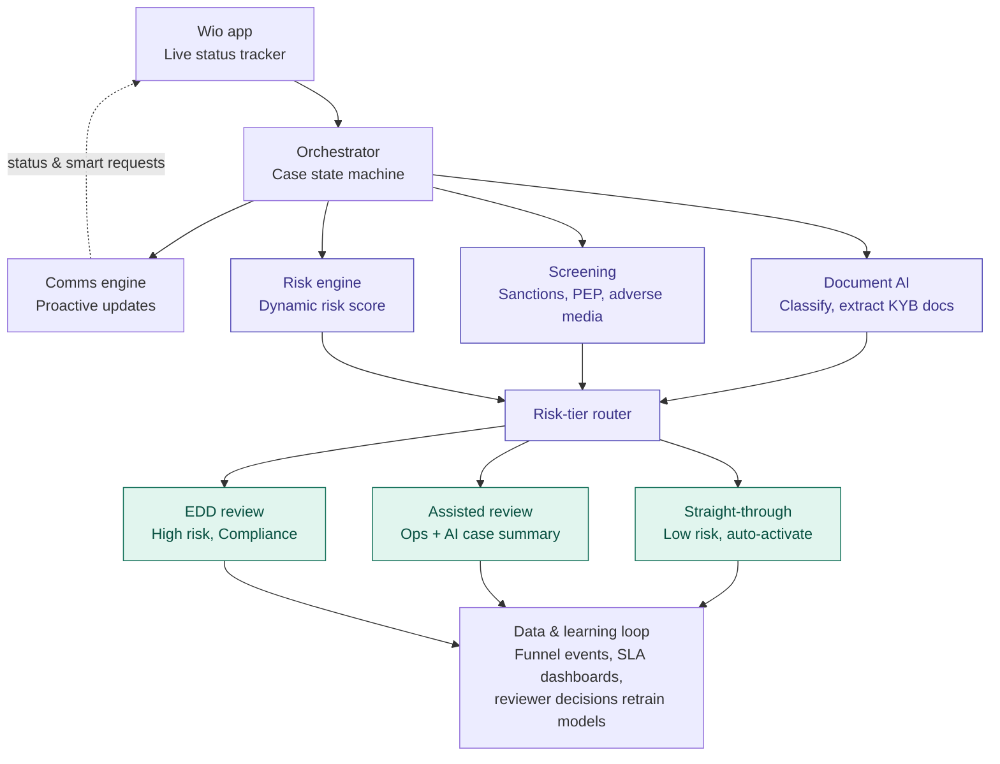

# Wio Home Task – Plan (Option 1: Designing a smarter onboarding journey)

## Why Option 1

| | Option 1: Onboarding | Option 2: Payment investigations | Option 3: Wio Family |
|---|---|---|---|
| Domain ramp-up | Low–medium (KYC/KYB) | High (SWIFT, recon, sanctions) | Low |
| Research possible from outside Wio | Strong – walk the funnel yourself, app reviews, public CBUAE rules | Weak – payment back-office is invisible | Strong – surveys, competitor apps |
| Architecture-diagram fit | Excellent | Excellent | Weak (product/GTM) |
| AI/automation story | Very high | Very high | Medium |
| Interview risk | Low | Medium – deep domain probing | Medium – "idea" answers easy to dismiss |

**Pick: Option 1.** It is the most doable (primary research is possible), aligns with Wio's core promise of fast SME/founder onboarding, and showcases all four asks: process design, communication, AI, and human judgement.

**Backup: Option 2** if you have a payments/fintech background and want to differentiate.

---

## Target architecture

Core idea: **risk-tiered routing instead of one-size-fits-all review** – AI handles the routine, humans handle judgement, and the customer always sees where they stand.

- **Orchestrator** – single source of truth for each application's state and SLA clock.
- **Comms engine** – every state change triggers a customer update, so customers never have to ask "what's happening?"
- **Document AI** – classifies and extracts non-standard KYB documents (trade licences, MOAs, shareholder structures).
- **Router** – most low-risk retail cases go straight through; humans only see exceptions, with an AI-generated case summary.
- **Learning loop** – every human decision feeds back to improve models and routing rules.

---

## Deliverable outline

### 1. Challenge understanding
- **Customers:** slow activation, unclear status, repeated document requests, low trust in the process.
- **Ops / Compliance / Tech:** manual review of non-standard docs, rework from incomplete submissions, inconsistent decisions, handoffs between teams.
- **Business:** drop-off = lost revenue, high cost-to-serve, brand risk vs. "fast digital bank" promise, regulatory risk if speed compromises controls.
- **Assumptions:** state clearly where numbers are illustrative (see funnel below).

### 2. Data, insights & research approach
- **Data wanted:** step-level funnel conversion, time-in-state per step, % cases needing more info (RFI) and number of RFI loops, manual review hours per case, reviewer decision variance, app reviews / CSAT / support tickets tagged "onboarding".
- **Sources:** onboarding event logs, case-management system, Ops/Compliance SLA dashboards, CRM/support tickets, app-store reviews, customer interviews.
- **Illustrative funnel (assumed):** Retail ~85% STP, activation in about a day; SME ~30% STP, 5–10 days.
- **Stakeholder questions:**
  1. (Ops) Which document types cause the most manual review and RFIs?
  2. (Compliance) Which risk factors truly require EDD vs. are reviewed "just in case"?
  3. (Compliance) Where does regulation require a human decision, and where is it policy choice?
  4. (Engineering) Where does the case state live today, and how many systems does one application touch?
  5. (Frontline/Support) What are the top three questions customers ask while waiting?
  6. (Product) Where in the app do applicants abandon, and what did they see last?
- **Patterns to look for:** drop-off by segment (freelancer vs. LLC vs. free-zone), long-tail cases (P90 vs. median), RFI loops by document type, reviewer-to-reviewer decision variance, time-of-day/queue backlogs.

### 3. Root-cause hypotheses
1. **Policy:** one-size-fits-all review – every SME gets the same depth regardless of risk; low-risk freelancers queue behind complex multi-shareholder entities.
2. **Process:** sequential, piecemeal RFIs – each clarification resets the clock; no single owner of end-to-end time-to-activation.
3. **Technology:** non-standard KYB documents are read manually because automation only covers standard formats; case state is fragmented across tools.

**Why they persist:** risk-averse incentives (no one is penalised for over-reviewing), legacy rules built for early scale, siloed team KPIs.

### 4. Proposed solution & impact
**Quick wins (0–3 months)**
- Smart document checklist up front, tailored to entity type and emirate.
- Single consolidated RFI instead of multiple rounds.
- In-app status tracker with an expected completion date.

**Long term (3–12 months)**
- Document AI for KYB extraction and classification.
- Risk-tiered routing (STP / assisted / EDD).
- AI case summaries for reviewers.
- Perpetual KYC – lighter at onboarding, continuous monitoring after.

**Disciplines:** engineering (orchestrator, integrations), data science (risk models, doc AI), design/UX writing (tracker, RFI copy), behavioural science (reducing anxiety while waiting), compliance (risk appetite and controls), operations (queue design).

**Trade-offs:** speed vs. risk (guardrail metrics), build vs. buy for document AI, model explainability for regulators, change management for reviewers.

**Success metrics**
- Median and P90 time-to-activation (retail and SME separately)
- STP rate
- RFI rate and RFI loops per case
- Step-level drop-off
- Manual review hours per case
- Reviewer decision consistency
- Onboarding CSAT / NPS
- **Guardrail:** false-negative rate – speed must not let more risk through

### 5. Execution & collaboration plan
| Phase | Duration | Goal |
|---|---|---|
| Discover | 2 weeks | Baseline funnel and SLA data, stakeholder interviews, validate root causes |
| Design | 3 weeks | Risk-tier rules with Compliance, tracker and RFI UX, doc AI vendor shortlist |
| Pilot | 6 weeks | One segment (e.g. freelancers), A/B against current flow |
| Scale | Ongoing | Roll out to other SME segments, retrain models from reviewer decisions |

- **Cadence:** weekly cross-functional check-in (Ops, Compliance, Product, Eng), shared funnel/SLA dashboard, fortnightly steering update.
- **Prioritise first:** consolidated RFI + status tracker – cheap, fast, and directly reduce customer anxiety and loops while the bigger automation work is built.

---

## 5-day working plan

| Day | Work | Section |
|---|---|---|
| 1 | Walk Wio's retail and business onboarding (or recordings), map every step and handoff, mine app-store reviews and Reddit, skim CBUAE KYC/AML requirements | §1, §2 |
| 2 | Build the assumed funnel with clearly marked assumptions, write stakeholder questions and patterns to look for | §2 |
| 3 | Root causes, before/after process maps | §3 |
| 4 | Solution, trade-offs, metrics tree, roadmap, polish architecture diagram | §4, §5 |
| 5 | Build ~12–15 slides, rehearse to 25 minutes, prepare for "why not X?" questions | All |
